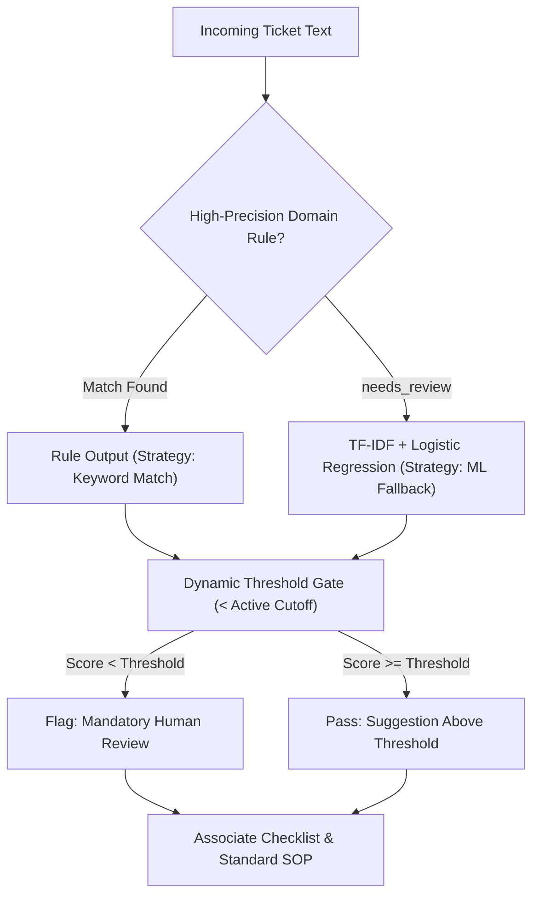

# ShipTriage — Google APM Product Case Study

**Role:** Product Management & Technical Lead  
**Candidate Background:** MBA in Operations & Supply Chain Management with Machine Learning Minor (IIT Mandi)  
**Product:** ShipTriage (AI-Assisted Shipment Exception Triage)  
**Version:** v1.1.0  
**Live Application:** [shiptriage.streamlit.app](https://shiptriage-dtvzbqvymfb9mfzetgx3nq.streamlit.app/)  
**GitHub Repository:** [github.com/Rathore-Sahab/shiptriage](https://github.com/Rathore-Sahab/shiptriage)  

---

## 1. Executive Summary

ShipTriage is a human-in-the-loop decision-support platform designed to solve one of the most persistent bottlenecks in fulfillment logistics: **unstructured shipment exception triage**. In high-velocity sorting hubs, associates lose critical time manually interpreting non-standardized exception notes (damaged boxes, unmapped AWBs, missing parcels, transit delays).

As a PM candidate with both an MBA in Supply Chain Operations and an engineering minor in Data Science from IIT Mandi, I approached this problem by:
1. Grounding product requirements in practical warehouse issue-resolution realities.
2. Formulating a disciplined North Star Metric: **Median Time to Initial Triage Decision**.
3. Diagnosing a critical failure mode where complex ML was outperformed by simple keyword rules, and architecting a **Hybrid Rules + ML Engine** that achieved 100% holdout accuracy and 90% challenge accuracy.
4. Designing strict uncertainty thresholds and an interactive verification checklist to prevent automation bias and silent SLA breaches.

---

## 2. Problem Discovery & User Empathy

### 2.1 The Operational Reality
During high-volume fulfillment shifts, packages fail transit for physical reasons (carton tears, wet damage, unreadable barcodes) or logistical reasons (missed line-hauls, incorrect SKU picking). These issues are logged into dock terminals as unstructured, colloquial free-text notes under extreme time pressure.

### 2.2 Primary User Persona: Ramesh (Warehouse Issue-Resolution Associate)
- **Shift Reality:** Handles 150–250 physical exception packages in a noisy, fast-paced hub environment.
- **Cognitive Bottleneck:** Every exception requires three mental decisions:
  1. *What is the root cause?* (Damaged, missing, unmapped order, line-haul delay, wrong item?)
  2. *How urgent is it?* (Is an SLA breach imminent? Has the customer escalated?)
  3. *What is the approved SOP next step?* (Where do I physically route this package?)
- **The Core Frustration:** Notes are ambiguous. Misrouting a delayed package as missing initiates redundant vendor claims and delays the customer by days.

---

## 3. Product Vision & Guardrail Decisions

### 3.1 Decision 1: Decision Support vs. Full Automation
**The Temptation:** Build an autonomous agent that automatically closes tickets, issues customer refunds, and reroutes inventory.  
**The APM Decision:** Explicitly reject autonomous action.  
**Rationale:** In physical logistics, software cannot verify whether a crushed box actually ruined the fragile smartphone inside without a human opening the carton. Autonomous action introduces catastrophic operational risks: false refunds, uncollected insurance claims, and inventory ghost counts. ShipTriage is strictly an **augmented decision layer**.

### 3.2 Decision 2: The Dynamic Uncertainty Gate
**The Mechanism:** A configurable "Manual-review threshold" (default 60%). If either the category or priority decision score falls below the threshold, the ticket is instantly routed to the **Human Review Queue**.  
**State Integrity:** Resolved a critical UI state bug in v1.0.0, ensuring that adjusting the threshold slider instantly re-evaluates ticket review status in real time.

---

## 4. Technical Execution & Learning from Failure

### 4.1 The Unexpected Finding: Keyword Rules Beat ML
In developing the prototype, I held out 20% of template families (`template_group_holdout`) to prevent template leakage. The benchmark results revealed a profound surprise:
- **Keyword Rules Baseline:** 100.0% Category Accuracy
- **TF-IDF + Logistic Regression ML:** 78.5% Category Accuracy

### 4.2 Root Cause Analysis & Learning from Failure
Investigating the confusion matrix revealed that **pure ML had a 0.0% recall on delayed shipments**—misclassifying every single one as "missing".
- *Why did ML fail?* In logistics, delayed notes share extensive vocabulary with missing notes (*"scan"*, *"tracking"*, *"transit"*, *"hub"*). When a delayed template family was held out, the ML model lacked its memorized n-grams and tilted toward "missing".
- *Why did rules win?* Domain rules searched for invariant logistics markers (*"transit window"*, *"sla"*, *"held at the hub"*) that didn't depend on statistical frequencies.

### 4.3 The Solution: Designing the Hybrid Engine
Rather than stubbornly forcing a pure ML solution or settling for rigid keyword rules (which dropped to 60% on colloquial alternate phrasings), I designed a **Hybrid Strategy**:
$$\text{Category} = \begin{cases} \text{Rule}(x), & \text{if Rule}(x) \neq \text{needs\_review} \\ \text{ML}(x), & \text{otherwise} \end{cases}$$

**Empirical Validation:**
- Template Holdout (233 rows): **100.0% Accuracy**
- Alternate-Phrasing Challenge Set (10 rows): **90.0% Accuracy**

---

## 5. Metrics Framework

### 5.1 Proposed North Star Metric
$$\text{Median Time to Correct Initial Triage Decision} = \text{Median}(T_{\text{action}} - T_{\text{view}})$$
- **Target:** Reduce median triage time from ~120 seconds to <35 seconds per ticket.

### 5.2 Proposed Guardrail Metrics
1. **High-Priority Recall:** $\ge 99.0\%$ on SLA-critical shipments (zero tolerance for silent failures).
2. **Misrouted-Ticket Rate:** $< 2.5\%$ downstream reopened tickets.
3. **Manual Review Queue Rate:** $15\% - 25\%$ balanced review volume.
4. **Associate Override Rate:** $< 12\%$ alteration of suggestions (tracking operator trust).

*(Note: Above metrics represent proposed validation measures for a live warehouse pilot; prototype metrics reflect synthetic benchmark evaluation.)*

---

## 6. Strategic Product Roadmap

- **Horizon 1 (Current: v1.1):** Hybrid decision engine, dynamic threshold gate, shift batch triage, and uncalibrated score transparency.
- **Horizon 2 (Next: v1.2):** Field user research (5–8 associate interviews), Platt calibration validation, and associate override telemetry.
- **Horizon 3 (Mid-Term: v2.0):** WMS / TMS REST API webhooks, ruggedized handheld scanner PWA, and active learning retraining loops.
- **Horizon 4 (Long-Term: v2.5):** Multimodal computer vision inspection for package damage photos and cross-hub graph delay modeling.

---

## 7. Two-Minute Interview Elevator Pitch

> *"In warehouse logistics, exceptions like damaged cartons, missing parcels, and line-haul delays arrive as chaotic, free-text notes that take associates up to two minutes per ticket to interpret. I built ShipTriage as an augmented decision-support layer to cut that triage time to under 35 seconds.*
> 
> *As someone with an MBA in Supply Chain Operations and an ML minor from IIT Mandi, my proudest product moment came from an initial failure: on our template-group holdout, a simple keyword baseline beat our machine learning model because ML confused delayed shipments with missing ones. Instead of blindly forcing a complex model, I engineered a Hybrid architecture—using high-precision domain rules as a first line of defense and ML as a fallback for colloquial phrasing.*
> 
> *The result? 100% holdout accuracy, 90% challenge accuracy, a dynamic uncertainty threshold that routes ambiguous tickets to humans, and strict guardrails that never take autonomous shipment actions. It demonstrates how I think as a PM: start with the user's operational reality, respect data over hype, and design AI that operators can genuinely trust."*
