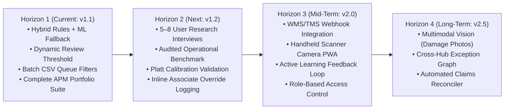

# ShipTriage — Product Roadmap & Strategic Vision

**Product:** ShipTriage (AI-Assisted Shipment Exception Triage)  
**Horizon Scope:** v1.1 Prototype $\longrightarrow$ v2.5 Enterprise Decision Layer  
**Target Milestone:** Google APM Portfolio Showcase & Production Pilot Strategy  

---

## 1. Product Vision & Long-Term Strategy

**Vision:** Transform chaotic, reactive warehouse exception handling into a predictive, standardized, human-supervised resolution workflow.

**Strategy:** Rather than replacing human operators with fragile fully autonomous AI, ShipTriage builds a trusted **augmented decision layer**. By combining high-precision domain rules, statistical machine learning, uncertainty thresholds, and ergonomic UX, ShipTriage protects high-velocity fulfillment networks from SLA breaches and costly misroutes.

---

## 2. Multi-Horizon Product Roadmap

---

## 3. Detailed Horizon Breakdown

### Horizon 1: Prototype Foundation & Decision Support (Shipped — v1.1)
- [x] **Hybrid Decision Engine:** Solved the "delayed vs missing" vocabulary blind spot (100% holdout, 90% alternate phrasing).
- [x] **Dynamic Threshold Reactivity:** Fixed session state bugs to guarantee real-time threshold recalculation.
- [x] **Uncalibrated Score Transparency:** Standardized UI disclosures clarifying decision margins vs probabilities.
- [x] **Shift Batch Workflow:** In-memory CSV validation, error handling, review queue filtering, and export.
- [x] **Human Verification SOP:** Interactive associate compliance checklist before action execution.
- [x] **Automated Zero-Config Cloud Deploy:** In-memory startup routine (`ensure_models_and_evaluation`).

### Horizon 2: User Validation & Operational Calibration (Target: Q1 2027 — v1.2)
- [ ] **Field User Research:** Execute 5–8 discovery interviews and think-aloud usability sessions using `USER_RESEARCH_TOOLKIT.md`.
- [ ] **Independently Labeled Operational Dataset:** Partner with logistics teams to audit 500+ real anonymized tickets.
- [ ] **Probability Calibration:** Fit and validate Platt scaling / Temperature scaling to convert margin scores into true Bayesian probabilities.
- [ ] **Associate Override Tracking:** Add an in-session button allowing associates to log *"I disagree with this category/priority"* to capture feedback loops.
- [ ] **Telemetry & Observability:** Track client-side latency, threshold adjustment frequencies, and filter usage.

### Horizon 3: Warehouse System Integration & Edge UX (Target: Q2–Q3 2027 — v2.0)
- [ ] **WMS / TMS REST API Connectors:** Two-way webhooks to ingest tickets directly from warehouse management systems (e.g. Manhattan, SAP EWM) and push structured tags back.
- [ ] **Handheld Scanner PWA:** Mobile-optimized progressive web app designed for Zebra / Honeywell ruggedized Android warehouse scanners.
- [ ] **Active Learning Pipeline:** Daily batch pipeline retraining the TF-IDF and rule dictionaries on associate-verified overrides.
- [ ] **Role-Based Access Control (RBAC):** Distinct roles for Warehouse Associates (Triage & Checklist) vs Facility Leads (Threshold Tuning & Performance Audits).

### Horizon 4: Multimodal Exception Intelligence (Target: 2028 — v2.5)
- [ ] **Computer Vision Damage Assessment:** Multi-modal ingestion of carton photos taken on dock terminals, verifying physical tear, puncture, or liquid leakage using fine-tuned vision models.
- [ ] **Cross-Hub Line-Haul Graph:** Graph neural network modeling transit network dependencies to predict line-haul delays before tickets are manually created.
- [ ] **Autonomous Claims Routing:** Low-value, high-certainty damaged items automatically route to vendor salvage claims with supervisory spot audits.

---

## 4. Product Trade-Offs & Deprioritized Features

| Feature Considered | Decision | Strategic Rationale |
|---|---|---|
| **Autonomous Ticket Closure** | **Rejected (Guardrail)** | Catastrophic operational failure mode. A missed delivery or damaged parcel closed without physical verification leads to customer churn and uncollected insurance claims. |
| **Heavy Deep Learning (BERT / LLM API)** | **Deprioritized** | Large Language Models introduce 500ms+ network latency, costly cloud API bills, non-deterministic outputs, and data privacy risks. TF-IDF + Logistic Regression delivers sub-5ms local inference at zero marginal cost. |
| **Complex Database / User Auth in MVP** | **Deferred to v2.0** | Adding user accounts and SQL databases in an initial portfolio prototype introduces deployment friction without proving core triage value. Prioritized UX clarity and ML transparency first. |
